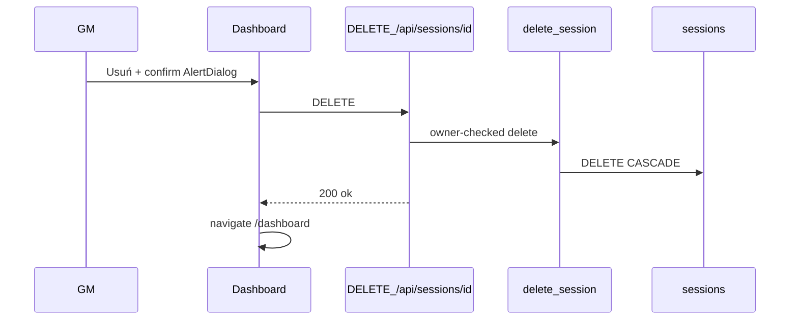

# GM Delete Session — Plan Brief

> Full plan: `context/changes/gm-delete-session/plan.md`

## What & Why

MG cannot remove old sessions, so the dashboard fills with clutter after real table play (US-02 / FR-003). This slice adds hard delete after confirmation so the GM can clean any-status sessions without accidental one-click loss.

## Starting Point

Soft close-as-replaced exists (`close_session_as_replaced`); sessions CASCADE-delete children at the DB layer, but there is no DELETE API, RLS policy, or UI. The dashboard list is full-row links with a “Pokaż zamknięte” toggle only.

## Desired End State

From `/dashboard`, MG opens Usuń → AlertDialog → confirm, and the session row is gone for active and closed alike. Cancel leaves everything unchanged. Players with a deleted code see the same 404 as an unknown code.

## Key Decisions Made

| Decision | Choice | Why (1 sentence) |
| -------- | ------ | ---------------- |
| Semantics | Hard DELETE (CASCADE) | Matches regenerate’s deferred hard-delete and prepared FKs; “znika z listy” means the row is gone |
| Confirm strength | Same one-step for all statuses | Warning copy stronger when active; no type-to-confirm friction for cleanup |
| Surface | Dashboard list only | US-02 is list cleanup; board page stays play-focused |
| Confirm chrome | shadcn AlertDialog | Clear modal focus/escape; first dialog primitive in the kit |
| Players after delete | Unknown-code 404 | Simplest contract; abrupt mid-game loss accepted with active warning copy |
| API | SECURITY DEFINER `delete_session` + `DELETE /api/sessions/[id]` | Mirrors close/undo RPC posture; no broad DELETE RLS |
| Testing | Integration auth matrix + happy path | Locks route/auth like `close-session.test.ts`; no Playwright |

## Scope

**In scope:** Migration/RPC; delete API + service; dashboard row delete + AlertDialog; kitchen-sink confirm states; integration tests; test-plan cookbook note.

**Out of scope:** Soft-delete; delete on session detail page; type-to-confirm; Playwright; bulk delete; recycle bin; changing closed-board snapshot for non-deleted codes; RLS DELETE policies.

## Architecture / Approach

## Phases at a Glance

| Phase | What it delivers | Key risk |
| ----- | ---------------- | -------- |
| 1. Delete contract (DB + API) | RPC + `DELETE /api/sessions/[id]` | Owner check wrong → cross-GM delete or false 404 |
| 2. Dashboard delete UX | AlertDialog + list row actions + kitchen-sink | Button nested in link; demo mode hitting API |
| 3. Integration verification | Auth matrix + play 404 + cookbook | Closed-delete fixture setup wrong |

**Prerequisites:** Local Supabase for migration/tests; existing close/create helpers.
**Estimated effort:** ~1–2 sessions across 3 phases.

## Open Risks & Assumptions

- Deleting an active session mid-play is intentional after confirm; no grace period.
- `replaced_by_session_id` back-links SET NULL when a successor is deleted — closed history may lose the successor code pointer.
- Astro can host `src/pages/api/sessions/[id].ts` alongside `[id]/close.ts` without conflict.

## Success Criteria (Summary)

- MG deletes any owned session from the dashboard only after AlertDialog confirm; cancel is a no-op.
- Deleted codes behave as unknown for players (404).
- Integration tests cover unauth/foreign/unknown/active/closed delete paths.
