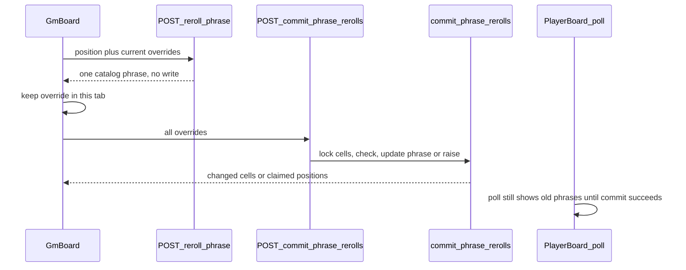

# GM Reroll Free Cell Implementation Plan

## Overview

Deliver FR-018: on an active session the game master replaces the phrase on one or more free cells, keeps each cell's reward, and publishes the whole draft with one confirmation. Other people keep seeing the published phrases until that confirmation. This is `rerollPhrase`, not `regenerateBoard`.

## Current State Analysis

- A cell stores `phrase` text and `reward_id` separately. `(session_id, phrase)` is unique on the exact text. There is no `UPDATE` policy for the GM; claim and undo go through `SECURITY DEFINER` functions (`supabase/migrations/20260927143000_sessions_and_board_cells.sql`, `supabase/migrations/20261003200000_undo_board_cell.sql`).
- `generateBoard` draws once at create from the catalog plus custom inputs, using `normalizePhrase` (`src/lib/services/board-generator.ts`). Custom inputs and the "guaranteed" flag are not stored. After create, the only phrase text that still exists is `board_cells.phrase`. The catalog seed has 40 phrases (`supabase/seed.sql`).
- The only in-place GM mutation is undo claim: `POST /api/sessions/[id]/undo-claim` → `undoBoardCell` → `undo_board_cell`. It requires an active session and `gm_id = auth.uid()`, and it does not change `phrase` or `reward_id`.
- `GmBoard` polls `GET /api/sessions/[id]/board` every 5 seconds (`POLL_MS` in `src/components/sessions/GmBoard.tsx`). `PlayerBoard` polls on the same interval. Players read phrases from `get_active_board_by_code`. Nothing in `src/` drafts or publishes a phrase change.
- Closed sessions stay on screen for the GM and for players, but undo and regenerate controls are active-only.

## Desired End State

On an active session the GM enters edit mode from an icon-only pencil button immediately to the right of **Wygeneruj nową planszę**, then clicks free cells and sees a new catalog phrase on each clicked cell immediately. The reward badge does not change. A joined player still sees the published phrases. **Anuluj** discards the whole draft. **Zatwierdź** writes every drafted phrase or writes none.

Worked example, 5×5, catalog of 40 phrases:

- Cell A shows the custom phrase `Smok zjadł konia`, which is not in the catalog. Cell B shows a catalog phrase. After A is rerolled, a later draw for B cannot return `Smok zjadł konia`.
- Cell A shows catalog phrase `Oswój zwierzę` and the draft replaces it. A later draw in that same draft can return `Oswój zwierzę` for another cell, because it is still in the catalog and is no longer visible.
- Cell 7's draft phrase is `Oswój zwierzę` while players still see `Wespnij się na wysoki mur`. A player claims cell 7 before **Zatwierdź**. Nothing is published. The player keeps `Wespnij się na wysoki mur` and the reward. The GM can drop only cell 7 from the draft and publish the other drafted cells.

Refresh, or the same session opened in a second tab, shows the published board and an empty draft. A closed session has no edit control. The API rejects a non-owner and a closed session the same way undo does.

### Key Discoveries:

- Follow `undo_board_cell` / `POST /api/sessions/[id]/undo-claim` (`src/pages/api/sessions/[id]/undo-claim.ts`): origin check, 401, UUID 404, zod 400, Polish domain errors, `SECURITY DEFINER`, `REVOKE ALL` then `GRANT EXECUTE` to `authenticated`.
- `getSessionWithCells` (`src/lib/services/sessions.service.ts`) loads GM cells for a closed session too. Active-only must be an explicit check, as in `GmBoard`'s `undoEnabled`.
- Player visibility needs no new read model. Updating `board_cells.phrase` is enough for the next player poll.
- `GmBoard` already preserves in-progress undo chrome across a poll. Edit mode needs the same treatment for local overrides.
- `src/pages/sessions/board/kitchen-sink.astro` and `GmBoard` are already in `scripts/check-ui-literals.mjs`. New chrome uses role classes only.

## What We're NOT Doing

- Typing a phrase or picking one from a list. The system draws.
- Changing `reward_id`, claim columns, line rewards, or threshold rewards.
- Rerolling a claimed cell, or publishing a new phrase onto a cell that is claimed at commit time.
- A server-side draft, a draft that survives refresh, or one shared draft across tabs.
- A per-cell "restore published phrase" control on a cell that is still free. Clicking it draws again.
- Blocking player claims while edit mode is open.
- `regenerateBoard`, a new session code, or another board under the same code.
- Storing custom phrases that never landed on the board. After a successful publish, a custom phrase that is not in the catalog cannot be drawn again. **Anuluj** before publish still shows it, because the server has not written.
- Signing draws. A modified client can submit any catalog phrase that passes the commit checks. The server still rejects a non-catalog phrase, a normalized duplicate, and a claimed cell.
- A new Playwright spec. Coverage is unit, integration, and the existing board kitchen sink.
- Realtime. Players keep the 5 second poll (visible within the existing 10 second NFR).
- Edit on a `closed` session.
- A visible text label on the edit entry button, or a second entry button on the board. Entry is the header pencil.
- Protecting create-time "guaranteed" customs. That flag is not stored.

## Implementation Approach

Two GM requests, no new table. A click asks the server to draw; the browser tab holds the resulting phrase as an override. **Zatwierdź** sends the whole override set. One `SECURITY DEFINER` function locks the session's cells, checks every target, and either updates `phrase` on all of them or raises and leaves the published board untouched.

Draw exclusion is the board the GM sees: the published phrase, replaced where the client sent an override. The pool is `phrases.text` minus those visible phrases, compared with `normalizePhrase`. Commit does not trust the draw. It reloads cells under the lock and accepts a change only when the cell is free, the new text equals a catalog row, and the resulting board has no normalized duplicate.



## Critical Implementation Details

**Commit lock.** `commit_phrase_rerolls` takes `FOR UPDATE` on the session's `board_cells` before the claim check. If any target has `claimed_by_player_id` set, it raises and updates nothing. A claim that lands during the check cannot keep a half-applied phrase list.

**Normalized uniqueness.** `UNIQUE (session_id, phrase)` compares exact text, so `Oswój zwierzę` and `Oswój zwierzę ` would both fit. The RPC rejects a resulting board that collides under the SQL twin of `normalizePhrase`: trim, collapse whitespace, then lower. Draw uses the JS function. The integration test commits a second cell to the trimmed form of a phrase that is still visible and expects the whole commit to fail with no phrase change.

**Entry control.** The control is an icon-only button in the header of `/sessions/[id]`, the right-hand sibling of `GmRegenerateControls` (the **Wygeneruj nową planszę** button in the `grid-cols-[1fr_auto]` row, `src/pages/sessions/[id].astro`). It uses the Lucide pencil, no visible text, `aria-label="Wymień hasła"`, the same outline size as that inline regenerate button, and `cursor-pointer`. It shows only when the regenerate control shows: active session and a complete board. Those two controls are separate `client:load` islands, so the click must reach `GmBoard` without a reload and without a second entry button on the board.

**Draft versus poll.** While edit mode is on, a poll may replace published cell state, then the tab reapplies its overrides. A free cell's only edit action is another draw. Undo confirm on a claimed cell with no override stays available, including during edit mode, so the GM can clear a claim and then publish. A drafted cell that becomes claimed shows the rejection recovery, not a new draw: **Usuń zajęte ze szkicu** drops overrides only for positions named by the failed commit. **Zatwierdź** stays disabled when there are no overrides, shows a loader while the request runs, and the new buttons use `cursor-pointer`.

## Phase 1: Phrase reroll on a free cell

### Overview

Ship the catalog draw, the atomic commit, both endpoints, and the GM edit mode, including kitchen-sink states.

### Changes Required:

#### 1. Catalog draw

**File**: `src/lib/services/reroll-phrase.ts`

**Intent**: One pure function decides which catalog phrase a click may show, so the API and the tests share the FR-018 pool rule.

**Contract**: `pickCatalogPhrase({ catalog, visiblePhrases, random })` returns one exact `phrases.text` value or throws `RerollPhraseError` `POOL_EMPTY`. Build the exclusion set with `normalizePhrase` from `src/lib/services/board-generator.ts`. A catalog row whose normalized form is already visible is out. Catalog rows that normalize to the same string count once. A visible custom phrase that is not in the catalog excludes that form and is never returned. `random` defaults to the same `crypto` draw `generateBoard` uses, and tests inject it. Unit file: `src/lib/services/reroll-phrase.test.ts`.

#### 2. Commit function

**File**: `supabase/migrations/YYYYMMDDHHmmss_commit_phrase_rerolls.sql`

**Intent**: Publish every drafted phrase in one transaction, or leave the published board unchanged, without granting `UPDATE` on `board_cells`.

**Contract**: `commit_phrase_rerolls(p_session_id uuid, p_changes jsonb)` is `SECURITY DEFINER` with `search_path = public`. `REVOKE ALL` from `PUBLIC`, `GRANT EXECUTE` to `authenticated`. Timestamp sorts after `20261011180000_session_players_threshold_roster.sql`.

- Resolve the session only when `id = p_session_id`, `gm_id = auth.uid()`, and `status = 'active'`. Otherwise `RAISE EXCEPTION 'session_not_found'`.
- `p_changes` is a non-empty JSON array of `{ "position": <int>, "phrase": <string> }` with unique positions. Empty, malformed, duplicate positions, out-of-range positions, or an unknown cell raise `invalid_position` or `cell_not_found` and write nothing.
- Lock the session's cells `FOR UPDATE` before checks.
- If any target cell is claimed, write nothing and raise `cell_claimed:` plus the claimed positions, comma-separated, ascending. The service parses that prefix.

```text
RAISE EXCEPTION 'cell_claimed:%', v_positions;
```

- Each new phrase must equal some `phrases.text` exactly. Otherwise raise `phrase_not_in_catalog` and write nothing.
- Apply the changes in memory to the locked phrases. If the resulting board collides under the SQL twin of `normalizePhrase`, raise `duplicate_phrase` and write nothing.
- `UPDATE` `phrase` only. Do not touch `reward_id`, `claimed_by_player_id`, or `claimed_at`.
- Return the updated rows needed to map the GM cell DTO (position, phrase, reward slug and label, claim color).

Add the function next to `undo_board_cell` in `src/db/database.types.ts`.

#### 3. Service and HTTP

**File**: `src/lib/services/sessions.service.ts`

**Intent**: Adapt the two operations to the same error style as `undoBoardCell`, and keep Postgres messages out of the UI.

**Contract**:

- `rerollPhrase({ sessionId, position, overrides })` loads the GM's cells and the catalog, requires `status = 'active'`, and refuses a claimed target with `CELL_CLAIMED` and that position. Visible phrase = override for that position when present, otherwise the published phrase. It calls `pickCatalogPhrase` and returns `{ phrase }`. It does not write.
- `commitPhraseRerolls({ sessionId, changes })` calls the RPC. Map `session_not_found`, `invalid_position`, `cell_not_found`, `phrase_not_in_catalog`, `duplicate_phrase`, and `cell_claimed:` (with positions) through a pure message parser, same shape as `undoErrorFromMessage`. Re-select the changed cells under GM RLS for the DTO, as undo does, and keep `reward_id` from that row.
- Domain error type carries `code` and, for `CELL_CLAIMED`, `positions: number[]`.

**File**: `src/lib/schemas/reroll-phrase.ts`, `src/lib/schemas/commit-phrase-rerolls.ts`, `src/types.ts`

**Intent**: Validate the browser payload before either call.

**Contract**: Draw body `{ position, overrides: { position, phrase }[] }`. Commit body `{ changes: { position, phrase }[] }` with at least one change, unique positions, phrase trimmed, length 1–120 (same max as `src/lib/schemas/session.ts`). Success types: `{ phrase: string }` and `{ cells: SessionWithCells["cells"] }`.

**File**: `src/pages/api/sessions/[id]/reroll-phrase.ts`, `src/pages/api/sessions/[id]/commit-phrase-rerolls.ts`

**Intent**: Expose the two operations with the undo route's gate order.

**Contract**: `POST` only, `prerender = false`. Origin 403 `{ error: "Forbidden" }`. No user 401 `{ error: "Wymagane logowanie" }`. Bad UUID 404 `{ error: "Nie znaleziono sesji" }`. Bad JSON or zod 400 with the first issue message. Domain map: `SESSION_NOT_FOUND` 404; `INVALID_POSITION` / `CELL_NOT_FOUND` / `PHRASE_NOT_IN_CATALOG` 400; `POOL_EMPTY` / `DUPLICATE_PHRASE` / `CELL_CLAIMED` 409. `CELL_CLAIMED` body is `{ error: "Pole jest już zajęte", positions }`. `POOL_EMPTY` body is `{ error: "Brak innego hasła w katalogu" }`. Other failures 500 with a Polish sentence and `reportError`. Draw success 200 `{ phrase }`. Commit success 200 `{ cells }`.

#### 4. GM edit mode

**File**: `src/pages/sessions/[id].astro`, `src/components/sessions/GmRerollEditButton.tsx`

**Intent**: Put entry to edit mode in the header, as an icon to the right of regenerate, instead of a labeled button on the board.

**Contract**: `GmRerollEditButton` is a sibling rendered immediately to the right of `GmRegenerateControls` in the existing header grid. Icon only (Lucide pencil), `aria-label="Wymień hasła"`, no visible label, same outline size as the inline regenerate button, `cursor-pointer`. Hidden when regenerate is hidden (session not active, or the board is incomplete). Activating it puts the `GmBoard` already on the page into edit mode with an empty override map. The board kitchen sink's gm-board header row gets the same sibling to the right of its `GmRegenerateControls`.

**File**: `src/components/sessions/GmBoard.tsx`

**Intent**: Let the GM build a tab-local draft and publish it, without the player poll seeing those phrases early and without a second restore gesture on free cells.

**Contract**:

- Do not render a text **Wymień hasła** button. Edit mode starts from `GmRerollEditButton` with an empty override map.
- A click on a free cell, with or without an override, `POST`s the draw with the current overrides and stores the returned phrase on that position. The reward badge stays. A second click draws again; it does not restore the published phrase.
- **Anuluj** clears the overrides and leaves edit mode. Nothing is written.
- **Zatwierdź** is disabled when the override map is empty. It `POST`s every override. On 200, patch those cells, clear the draft, and leave edit mode. On 409 `CELL_CLAIMED`, stay in edit mode, name the positions, and show **Usuń zajęte ze szkicu**, which deletes overrides only for those positions. Other overrides remain. On `POOL_EMPTY`, leave the draft as it was and show the error.
- Polls keep running. After applying the payload, reapply overrides. Do not clear the draft because a poll returned the published phrase.
- A claimed cell with no override keeps the existing undo confirm flow during edit mode. A claimed cell that still has an override does not draw and does not open a new undo confirm on that click; recovery is the 409 action above. The GM can still undo a different claimed cell.
- While a draw or commit is in flight, disable the edit actions and show a loader. Buttons use `cursor-pointer`. No optimistic phrase before the draw response.
- `preview` skips the network, as it does for undo. Seed edit mode, overrides, and the rejection banner through optional initial props so the kitchen sink can render them.

**File**: `src/pages/sessions/board/kitchen-sink.astro`

**Intent**: Give the edit states a visual gate next to the existing undo fixtures.

**Contract**: Add fixtures for edit mode with two overridden free cells, the empty-pool error, the rejected-commit banner with **Usuń zajęte ze szkicu**, an active header with the pencil icon to the right of **Wygeneruj nową planszę**, and a closed session with no pencil. Use role classes already on `GmBoard`. Do not add a new route.

#### 5. Integration coverage

**File**: `tests/integration/reroll-phrase.test.ts`

**Intent**: Prove the publish rule against a real session, including the claim race and the catalog boundary.

**Contract**: Same preview harness as `tests/integration/play-path-claim-undo.test.ts`. Cover: draw returns a catalog phrase not visible on the draft board; draw of a claimed cell writes nothing; commit leaves `reward_id` and claim columns unchanged; commit of a non-catalog phrase (the `Smok zjadł konia` case) writes nothing; a normalized duplicate writes nothing; when one drafted cell is claimed before commit, every drafted phrase stays at its published text and the response lists that position; a second commit without that position updates the remaining cell; player `GET` shows the old phrase before commit and the new phrase after; non-owner and `closed` session get the not-found path.

### Success Criteria:

#### Automated Verification:

- `npm run test:unit` passes, including catalog-only draw, a displaced catalog phrase becoming eligible, a non-catalog custom never drawn, an empty pool, and `normalizePhrase` collisions
- `npm run lint` passes
- `npx astro check` passes
- `npm run test:integration` covers draw and commit: `reward_id` unchanged, non-catalog phrase rejected, duplicate rejected, a claimed cell rejects the whole set with no phrase change, non-owner and closed session rejected, player snapshot unchanged until commit

#### Manual Verification:

- GM rerolls two free cells on an active session; a joined player keeps the old phrases until Zatwierdź, then sees the new ones within 10 seconds with the same reward presence
- Anuluj drops the whole draft; clicking an already rerolled free cell draws again and does not restore its published phrase
- A claim on a drafted cell before Zatwierdź publishes nothing; GM can drop only that claimed cell from the draft and publish the other
- When no catalog phrase sits outside the visible draft, the click reports failure and leaves the draft unchanged
- A closed session shows no edit control; kitchen-sink fixtures cover edit, empty pool, rejected commit, and closed
- The edit entry control is an icon-only pencil immediately to the right of **Wygeneruj nową planszę**, with no visible text; a closed session does not show it

**Implementation Note**: After completing this phase and all automated verification passes, pause here for manual confirmation from the human that the manual testing was successful before proceeding to the next phase. Phase blocks use plain bullets — the corresponding `- [ ]` checkboxes for these items live in the `## Progress` section at the bottom of the plan.

---

## Testing Strategy

### Unit Tests:

- `pickCatalogPhrase` excludes every visible normalized form, returns exact catalog text, and can return a catalog phrase that the draft removed from a cell.
- `Smok zjadł konia`, present only in `visiblePhrases`, is never returned.
- Empty eligible catalog throws `POOL_EMPTY`.
- Injected `random` makes the chosen row deterministic.
- The commit message parser maps `cell_claimed:7,12` to positions `[7, 12]` and maps the other RPC names without a live database.

### Integration Tests:

- Create a session, draw, and commit through the two endpoints with the GM cookie.
- Race: join a player, claim a drafted position, commit, assert every `phrase` is unchanged, then commit the remaining change and assert only that cell's phrase changed.
- Player board read before and after the successful commit.
- Closed session and a second user.

### Manual Testing Steps:

1. Open the GM board and a joined player. Click the pencil immediately to the right of **Wygeneruj nową planszę**, reroll two free cells, and confirm the player still shows the old phrases.
2. Cancel and confirm the GM board matches the player again. Reroll one cell twice and confirm the phrase changes rather than reverting.
3. Reroll two cells, claim one as the player, confirm **Zatwierdź**, then drop only the claimed cell and publish the other. Confirm rewards and occupancy.
4. On a board that already shows every catalog phrase, confirm the extra click fails and the draft stays.
5. Close the session, or use the kitchen sink, and confirm the pencil is absent. On an active board, confirm it sits to the right of **Wygeneruj nową planszę** and has no visible text. Check the new kitchen-sink states at `/sessions/board/kitchen-sink`.

## Performance Considerations

A draw reads the catalog (40 seeded rows today) and one session's cells. A commit locks that session's cells once and updates at most `size²` phrase strings. No new player query and no realtime channel. The existing 5 second poll is the publish path.

## Migration Notes

No new column and no backfill. Existing boards keep their phrases until a GM commits. Rolling back the migration drops `commit_phrase_rerolls` only. Phrase text already committed is data, not schema; a code rollback does not restore it. Apply the migration on local Supabase before `npm run test:integration`.

## References

- Requirement: FR-018 in `context/foundation/prd.md`; term `rerollPhrase` in `context/domain/glossary.md`; `context/changes/gm-reroll-free-cell/change.md`
- Pattern: `supabase/migrations/20261003200000_undo_board_cell.sql`, `src/pages/api/sessions/[id]/undo-claim.ts`, `src/lib/services/sessions.service.ts` (`undoBoardCell`, `getSessionWithCells`)
- Phrase identity: `normalizePhrase` in `src/lib/services/board-generator.ts`
- Prior boundary: `context/archive/2026-10-11-gm-regenerate-board/plan.md` (new session, not an in-place phrase edit); `context/archive/2026-10-03-gm-undo-field-claim/plan.md`

## Progress

> Convention: `- [ ]` pending, `- [x]` done. Append ` — <commit sha>` when a step lands. Do not rename step titles. See `references/progress-format.md`.

### Phase 1: Phrase reroll on a free cell

#### Automated

- [x] 1.1 `npm run test:unit` passes, including catalog-only draw, a displaced catalog phrase becoming eligible, a non-catalog custom never drawn, an empty pool, and `normalizePhrase` collisions
- [x] 1.2 `npm run lint` passes
- [x] 1.3 `npx astro check` passes
- [x] 1.4 `npm run test:integration` covers draw and commit: `reward_id` unchanged, non-catalog phrase rejected, duplicate rejected, a claimed cell rejects the whole set with no phrase change, non-owner and closed session rejected, player snapshot unchanged until commit

#### Manual

- [x] 1.5 GM rerolls two free cells on an active session; a joined player keeps the old phrases until Zatwierdź, then sees the new ones within 10 seconds with the same reward presence
- [x] 1.6 Anuluj drops the whole draft; clicking an already rerolled free cell draws again and does not restore its published phrase
- [x] 1.7 A claim on a drafted cell before Zatwierdź publishes nothing; GM can drop only that claimed cell from the draft and publish the other
- [x] 1.8 When no catalog phrase sits outside the visible draft, the click reports failure and leaves the draft unchanged
- [x] 1.9 A closed session shows no edit control; kitchen-sink fixtures cover edit, empty pool, rejected commit, and closed
- [x] 1.10 The edit entry control is an icon-only pencil immediately to the right of **Wygeneruj nową planszę**, with no visible text; a closed session does not show it
