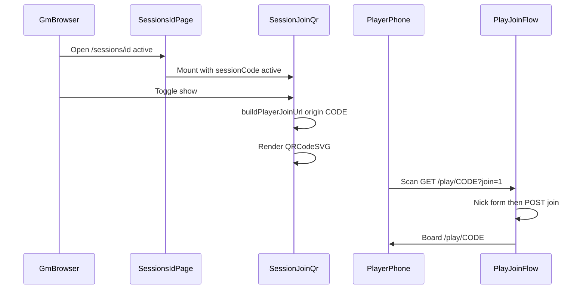

# Player join via QR — Implementation Plan

## Overview

Ship a GM-board QR control that is hidden by default, revealed by a toggle button, and encodes the existing join deep link so players skip typing the app URL and session code. Typed-code join stays untouched. No schema, auth, or join-API changes.

## Current State Analysis

- Deep link already works: `/play/{CODE}?join=1` → nick form → board (`src/pages/play/index.astro`, `src/pages/play/[code].astro`). Typed entry: GET `/play?code=` → same URL.
- GM table surface: `src/pages/sessions/[id].astro` shows large mono `session.code` (~L116–121); islands use `client:load` (`GmRegenerateControls`, `GmBoard`). No absolute join URL or QR today.
- Join POST CSRF stays on same-origin via `src/lib/request-origin.ts` — QR only opens a GET; nick form POST is unchanged.
- Regenerate creates a **new** session/code; QR must bind to the current page’s code (stale projected QR until refresh is accepted).
- No QR dependency in `package.json`. Regression surface: `tests/e2e/public-join-path.spec.ts`, `tests/e2e/seed.spec.ts`, join integration suites.

### Key Discoveries

- QR product work is UI + absolute URL + lib; join routing/API can stay as-is.
- Closed sessions already have successor chrome; QR control should not appear when `status !== "active"`.
- Board kitchen-sink at `src/pages/sessions/board/kitchen-sink.astro` mirrors header chrome — extend for collapsed/expanded QR states.
- QR modules must stay high-contrast black/white for cameras (not Vintage Paper theme colors).

## Desired End State

- On an **active** GM board, a button toggles a QR panel (hidden by default). Revealed panel shows QR only + accessible label; session code remains in the existing header.
- Encoded value: `{window.location.origin}/play/{CODE}?join=1`.
- Closed sessions: no QR control.
- Unit coverage for the URL helper; e2e reveals QR and asserts encoded payload; existing typed-code join e2e still passes.
- Kitchen-sink covers collapsed and expanded states.

## What We're NOT Doing

- Changing typed-code join, nick rules, cookies, or join/claim APIs
- QR on dashboard list rows
- Copyable join URL / plain-text URL under the QR
- Native mobile app or camera-in-app scanner
- Encoding cookie-aware `/play/{CODE}` without `?join=1`
- Successor-encoded QR on closed boards
- Schema/migrations / new roles
- Theming QR modules to brand colors

## Key Decisions

| Decision   | Choice                                                           | Why                                              |
| ---------- | ---------------------------------------------------------------- | ------------------------------------------------ |
| Target URL | `/play/{CODE}?join=1`                                            | Reuses proven deep link + e2e contract           |
| Surface    | GM board only; hidden until button                               | Table projector; less chrome                     |
| Closed     | Hide control                                                     | Avoid dead joins; use successor session page     |
| Render     | Client island; generate on first show; `window.location.origin`  | Origin matches phone target; lazy until needed   |
| Toggle     | Same button show/hide; keep QR in memory on page                 | Simple projector UX                              |
| Panel      | QR + a11y label only                                             | Minimal chrome                                   |
| Tests      | URL unit + e2e payload assert + keep typed-code e2e              | Catch wrong path without physical camera         |
| Lib        | `qrcode.react` (`QRCodeSVG`)                                     | Zero-dep React SVG; island-friendly              |

## Implementation Approach

Pure helper builds the path/query; island owns toggle + SVG; Astro page gates mount on `session.status === "active"`. Expose the absolute join URL on a `data-join-url` attribute when open so Playwright can assert without decoding SVG matrices.

---

## Phase 1: Join URL helper + unit tests

### Overview

Lock the canonical absolute join URL before UI work.

### Changes Required

#### 1. Join URL helper

**File**: `src/lib/player-join-url.ts` (new)

**Intent**: One pure function so QR UI, kitchen-sink demos, and tests share the same join URL contract.

**Contract**: `buildPlayerJoinUrl(origin: string, code: string): string` → `{origin}/play/{CODE}?join=1` with code uppercased/trimmed consistently with `SESSION_CODE_PATTERN` in `src/lib/services/session-code.ts`. Strip a trailing slash on `origin`. Assume caller passes a validated session code from the board page; unit tests use valid codes. No network I/O.

#### 2. Unit tests

**File**: `src/lib/player-join-url.test.ts` (new)

**Intent**: Freeze path, query flag, and origin joining.

**Contract**: Vitest unit project; cases for origin with/without trailing slash (strip trailing slash), uppercase/trim code, `join=1` present exactly once.

### Success Criteria

#### Automated Verification

- `npm run test:unit` passes for the new helper tests
- `npm run lint` clean for new files

#### Manual Verification

- None for this phase

---

## Phase 2: SessionJoinQr island + board wiring

### Overview

Add the toggleable QR island and mount it only on active GM boards.

### Changes Required

#### 1. Dependency

**File**: `package.json`

**Intent**: Provide SVG QR rendering inside a React island.

**Contract**: Add `qrcode.react`; use `QRCodeSVG` with high-contrast default black/white modules (scanner reliability). Do not theme QR to `primary` / paper tokens.

#### 2. SessionJoinQr island

**File**: `src/components/sessions/SessionJoinQr.tsx` (new)

**Intent**: Hidden-by-default QR for the table; generate on first reveal; toggle collapse without losing the generated value while mounted.

**Contract**:
- Props: `sessionCode: string`, `sessionStatus: "active" | "closed"` (or equivalent). If not `active`, render `null`. Optional sink-only `defaultOpen?: boolean` for kitchen-sink expanded state.
- UI: shadcn `Button` (match `src/components/sessions/GmRegenerateControls.tsx` patterns) toggles panel; Polish labels e.g. “Pokaż kod QR” / “Ukryj kod QR”.
- On first open: `joinUrl = buildPlayerJoinUrl(window.location.origin, sessionCode)`; render `QRCodeSVG` with `value={joinUrl}`, accessible name (e.g. `aria-label` / title “Dołącz do sesji”).
- When open, set `data-join-url={joinUrl}` on a stable wrapper for e2e.
- No plain-text URL, no copy control. Use `cn()`; no palette/hex in surrounding chrome (QR module colors exempt as scanner requirement).
- `client:load` from Astro.

#### 3. Wire GM board page

**File**: `src/pages/sessions/[id].astro`

**Intent**: Place the control on the table-facing header next to the existing code.

**Contract**: Mount `<SessionJoinQr sessionCode={session.code} sessionStatus={session.status} client:load />` under the code / meta row for the success branch when a session exists. Closed boards get no useful control (component returns null). Do not change regenerate/board islands.

### Success Criteria

#### Automated Verification

- `npm run lint` passes (include new component; keep role classes on chrome)
- `npm run build` succeeds with the new dependency

#### Manual Verification

- Active session: button hidden panel → show → scannable QR → hide → show again without error
- Closed session: no QR button
- Phone or second browser: open encoded URL → nick form → board (smoke at table)

---

## Phase 3: Kitchen-sink states + e2e regression

### Overview

Visual gate + automated proof of payload + guard typed-code join.

### Changes Required

#### 1. Board kitchen-sink

**File**: `src/pages/sessions/board/kitchen-sink.astro`

**Intent**: Dev-only visual states for collapsed and expanded QR on active header chrome; confirm closed header has no control.

**Contract**: Sections (or demo props) for QR collapsed, QR expanded (may use `defaultOpen` on the island for sink-only), and closed session header without QR. Keep PROD 404 behavior of kitchen-sink routes unchanged.

#### 2. E2E: QR payload

**File**: `tests/e2e/` (new spec or extend an existing GM-board authenticated flow)

**Intent**: Prove the revealed QR encodes the canonical join URL without a physical camera.

**Contract**: As GM on an active `/sessions/{id}`, click show QR, read `data-join-url` (or equivalent), assert it equals `{origin}/play/{CODE}?join=1` for that session’s code. Do not require camera APIs.

#### 3. Typed-code join regression

**File**: `tests/e2e/public-join-path.spec.ts` (run, not rewrite unless broken)

**Intent**: Hard guardrail from prd-v2 / roadmap S-01.

**Contract**: Existing home → code → nick → board path still passes in CI / `npm run test:e2e`.

### Success Criteria

#### Automated Verification

- New QR e2e passes
- `npm run test:e2e` includes passing `public-join-path` (typed-code join)
- `npm run lint` / `npm run test:unit` still green

#### Manual Verification

- Kitchen-sink collapsed/expanded/closed look correct on `/sessions/board/kitchen-sink`
- Optional: real phone scan against local/preview once

---

## Testing Strategy

### Unit Tests

- `buildPlayerJoinUrl` origin slash, code normalize, `join=1` (`src/lib/player-join-url.test.ts`)

### E2E Tests

- Reveal QR on active GM board; assert `data-join-url`
- Keep `tests/e2e/public-join-path.spec.ts` as typed-code regression

### Manual Testing Steps

1. Active board: toggle QR show/hide twice
2. Closed board: confirm no QR control
3. Second device: open encoded URL → nick → board
4. Kitchen-sink collapsed / expanded / closed

## Open Risks & Assumptions

- `window.location.origin` in local `astro dev` / preview must match what phones on the LAN can open (localhost vs LAN IP) — table testing may need the host the phone can reach; production Workers origin is fine.
- Stale QR after regenerate until MG opens the new session page is accepted product behavior.
- Session code remains the table secret in the URL (prior join design).

## References

- Roadmap S-01: `context/foundation/roadmap.md`
- PRD: `context/foundation/prd-v2.md` (US-01, Scope Dołączanie, Constraints)
- Prior join: `context/archive/2026-10-03-player-join-shared-board/`

## Progress

> Convention: `- [ ]` pending, `- [x]` done. Append ` — <commit sha>` when a step lands. Do not rename step titles.

### Phase 1: Join URL helper + unit tests

#### Automated

- [x] 1.1 Unit tests pass for join URL helper (`npm run test:unit`) — 93adaac
- [x] 1.2 Lint clean for new helper files (`npm run lint`) — 93adaac

### Phase 2: SessionJoinQr island + board wiring

#### Automated

- [x] 2.1 Lint clean with new island + dependency (`npm run lint`)
- [x] 2.2 Production build succeeds (`npm run build`)

#### Manual

- [ ] 2.3 Active board: toggle show/hide QR works; second show reuses panel
- [ ] 2.4 Closed board: no QR control
- [ ] 2.5 Encoded URL reaches nick form then board on a second device/browser

### Phase 3: Kitchen-sink states + e2e regression

#### Automated

- [ ] 3.1 QR reveal e2e asserts `data-join-url` / payload equals `/play/{CODE}?join=1`
- [ ] 3.2 Typed-code join e2e still passes (`public-join-path`)
- [ ] 3.3 Unit + lint still green

#### Manual

- [ ] 3.4 Kitchen-sink collapsed / expanded / closed states look correct
